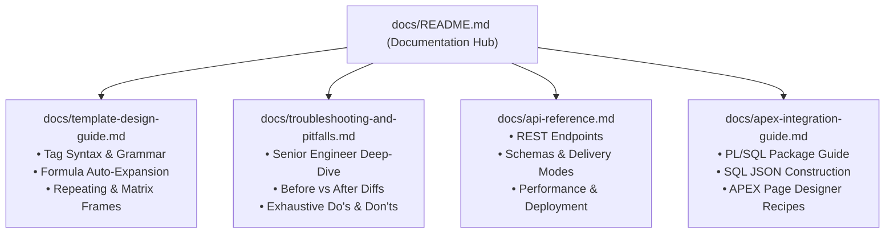

# ApexReports: Engineering Documentation Hub

Welcome to the **ApexReports** documentation hub. This suite of documentation is written from a Senior Software Engineer perspective to provide developers, architects, and Oracle APEX practitioners with complete technical clarity on designing, integrating, deploying, and troubleshooting the reporting engine.

---

## 🗺️ Documentation Index



| Guide | Description | Key Focus Areas |
| :--- | :--- | :--- |
| 📘 [**Template Design Guide**](file:///d:/Code/ApexReports/docs/template-design-guide.md) | Complete manual on authoring Excel templates (`.xlsx`). | Tag reference, repeating rows, matrix cross-tabs, dynamic formulas (`=SUM`, `=COUNTA`), dynamic barcodes, QR codes, and page breaks. |
| 🛡️ [**Troubleshooting & Pitfalls**](file:///d:/Code/ApexReports/docs/troubleshooting-and-pitfalls.md) | Senior Engineer root-cause analysis of common mistakes. | Merged cell overlapping, payload nesting mismatches, string-number concatenation, formula evaluation gaps, and Do's & Don'ts. |
| ⚡ [**REST API Reference**](file:///d:/Code/ApexReports/docs/api-reference.md) | Full technical specification of the FastAPI service. | Request/response schemas, binary streaming vs Base64 JSON envelopes, health diagnostics, and LibreOffice/Chrome runtime. |
| 🚀 [**Oracle APEX Integration**](file:///d:/Code/ApexReports/docs/apex-integration-guide.md) | Complete PL/SQL integration manual for APEX schemas. | `apex_reports_pkg` API, SQL `JSON_OBJECT`/`JSON_ARRAYAGG` queries, button downloads, AJAX modal previews, and `APEX_MAIL`. |

---

## ⚙️ Architecture Summary

ApexReports decouples **report template layout** (designed in Microsoft Excel) from **database query execution** (handled by Oracle SQL/PL/SQL):

```
┌────────────────────────┐         JSON Data Payload         ┌──────────────────────────────┐
│  Oracle Database/APEX  │ ────────────────────────────────> │     ApexReports Microservice │
│  (SQL Query Execution) │ <──────────────────────────────── │     (FastAPI + Python 3.12)  │
└────────────────────────┘      Binary Stream (PDF/HTML)     └──────────────┬───────────────┘
                                                                            │
                                                ┌───────────────────────────┴───────────────────────────┐
                                                ▼                                                       ▼
                                   [ Fast HTML Preview Path ]                               [ Vector PDF Conversion Path ]
                                     Latency: 10ms - 25ms                                     Latency: 150ms - 350ms
                                     • Formula Evaluator                                      • Pre-warmed LibreOffice Pool
                                     • Responsive CSS Tables                                  • or Headless Chrome Fallback
                                     • Embedded PNG Vectors                                   • Print Title Repeats & Margins
```

---

## 🏁 Quick Navigation

- Want to create your first report template? Start with the [Template Design Guide](file:///d:/Code/ApexReports/docs/template-design-guide.md).
- Running into blank pages, missing subtotals, or syntax errors? Check [Troubleshooting & Pitfalls](file:///d:/Code/ApexReports/docs/troubleshooting-and-pitfalls.md).
- Ready to wire up an APEX button or dynamic action? Head to the [Oracle APEX Integration Guide](file:///d:/Code/ApexReports/docs/apex-integration-guide.md).
